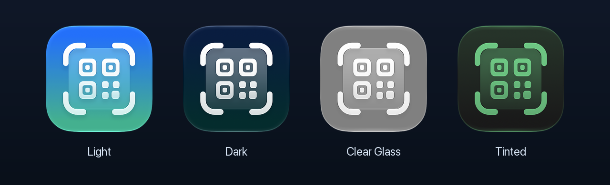
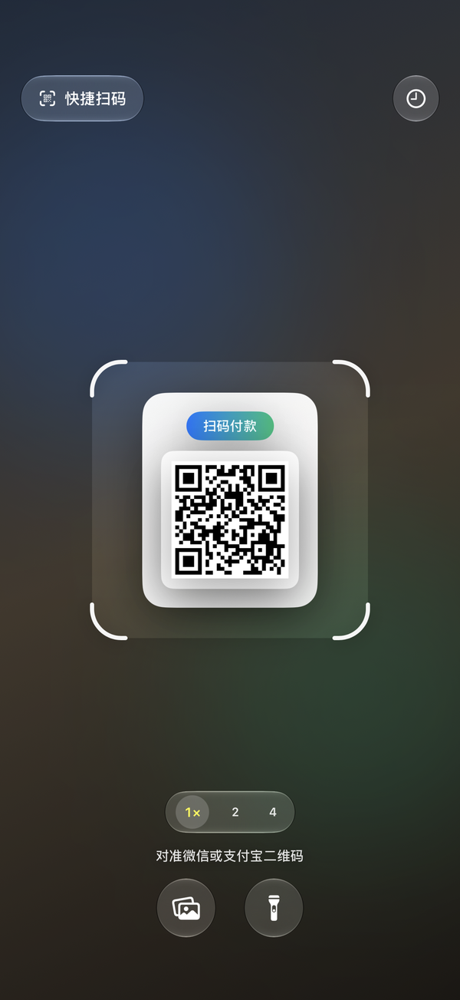
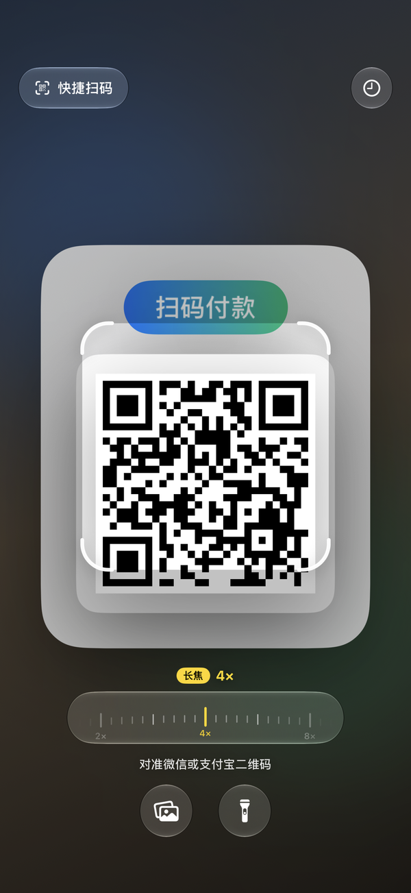
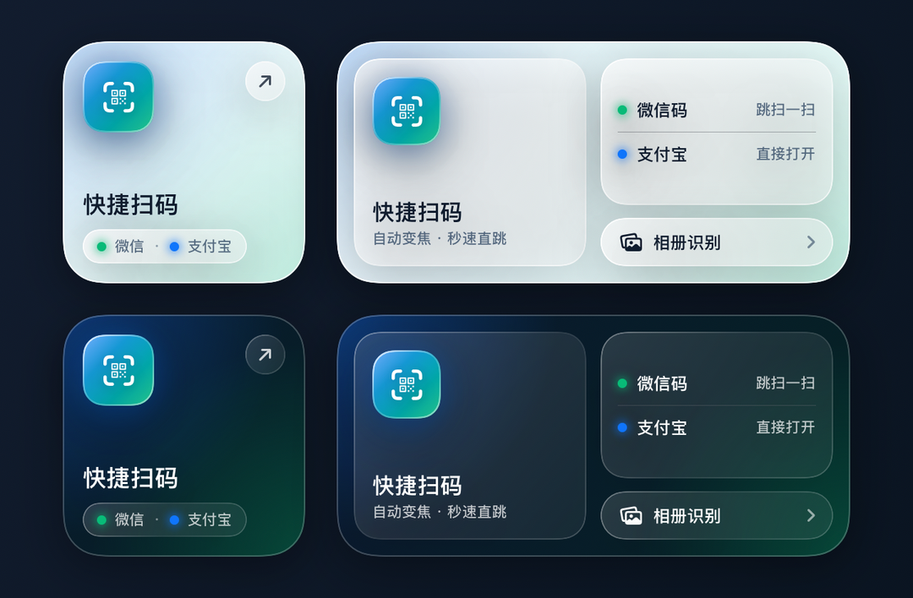

<div align="center">

# QuickScan · 快捷扫码

**为 iOS 26 / iOS 27 打造的原生液态玻璃（Liquid Glass）极速扫码 App**

自动识别微信 / 支付宝二维码无提示直跳 · 微信开源 CoreML SSD 远距自动光学变焦 · 系统相机同款长焦拨轮 · 桌面与锁屏小组件

<p>
  
</p>


-34C759?style=flat-square)


</div>

---

## 应用截图

<div align="center">
<table>
  <tr>
    <td align="center" width="33%">
      <br/>
      <sub><b>iOS 27 原生液态玻璃取景界面</b><br/>全屏通透遮罩 + 三档清透镜头胶囊</sub>
    </td>
    <td align="center" width="33%">
      <br/>
      <sub><b>系统相机同款对数刻度拨轮</b><br/>横向一滑展开 + 物理长焦镜头锁定</sub>
    </td>
    <td align="center" width="33%">
      <br/>
      <sub><b>iOS 27 液态玻璃桌面小组件</b><br/>自适应浅色 / 深色 / 透明玻璃 / 着色模式</sub>
    </td>
  </tr>
</table>
</div>

---

## 核心特性

- **微信 / 支付宝二维码自动识别、无提示直接跳转**
  - **微信二维码 → 跳转微信扫一扫**：覆盖 `wxp://` 个人收款码、`weixin://` / `wechat://` 支付码，以及 `u.wechat.com`、`weixin.qq.com`、`wechatpay.cn`、`wx.tenpay.com`、`wxaurl.cn`、`work.weixin.qq.com`、`servicewechat.com` 等常见码源，识别后无弹窗直接唤起 `weixin://scanqrcode`（备选 `weixin://`）。
  - **支付宝二维码 → 直接支付宝打开**：覆盖 `qr.alipay.com`、`*.alipay.com`、`*.alipay.cn`、`*.alipayplus.com`、`alipays://`、`alipay://`、`alipayqr://`，严格按 RFC 3986 编码参数并直接调起 `alipays://platformapi/startapp?saId=10000007&qrcode=<encoded>` 进入目标支付/业务页。
  - **普通 / 聚合收款码兜底**：扫描非微信/支付宝专属链接或第三方聚合码时，弹出原生玻璃操作面板，支持一键选择「支付宝打开」「微信扫一扫」「Safari 打开」或复制内容。
- **远距离微小二维码自动光学变焦（零第三方 SDK 依赖）**
  - 内置由微信开源 `detect` SSD 转换而来的原生 CoreML 模型（`WeChatQRDetector.mlmodel`，仅 ~957 KB），通过 `VNCoreMLRequest` + `.centerCrop` 运行在 Apple 神经引擎（ANE）上，单帧推理约 **4 ms**。
  - 即使远距离二维码仅占画面 ~5% 宽度尚无法解码，也能先精确定位并自动锁焦 + 平滑推近（`ramp(toVideoZoomFactor:withRate:)`），放大清晰后由硬件 `AVCaptureMetadataOutput` 瞬间秒解并直跳。
  - 内置防抖确认、手势礼让与离开画面自动回退 `1×` 机制。
- **iPhone Pro 虚拟三摄 + 物理长焦显式锁定 + 相机拨轮**
  - 自动读取 `.builtInTripleCamera` 硬件切换点（`virtualDeviceSwitchOverVideoZoomFactors`），清空 `fallbackPrimaryConstituentDevices` 并结合 iOS 27 原生 `setPrimaryConstituentDeviceSwitchingBehaviorLockedWith(_:)`，解决室内光线/中近距离停留在主摄数码裁切不切长焦的问题。
  - 底部焦距条平时收起为 `1× / 2× / 真机长焦档` 清透玻璃胶囊，横向一滑即展开为对数刻度 3D 弧面拨轮，支持 Taptic 刻度震动、光学焦段磁吸对齐及实时物理镜头回显（`主摄` / `长焦`）。
- **纯粹 iOS 27 原生液态玻璃体验**
  - 全面采用 SwiftUI `GlassEffectContainer`、`.glassEffect(.clear.interactive())`、`.buttonStyle(.glass)` / `.glassProminent`、`ConcentricRectangle` 与 **Icon Composer 多层 `.icon` 液态玻璃图标**。
  - 支持从系统相册选图识别（CoreImage + Vision 双引擎兜底）、点击对焦、双指变焦、手电筒与本地最近 30 条扫码记录。
  - 提供桌面小号/中号与锁屏小组件，并注册 `quickscan://scan` / `quickscan://album` 深链与 `AppIntents`（「打开扫码」/「从相册识别二维码」），零延迟开屏即扫。

---

## 推荐用法（零中转 4 键桌面快捷支付组件）

受 iOS WidgetKit 沙箱与 `OpenURLIntent` 限制，任何第三方小组件直接跳支付宝/微信都必须先经过自身主 App 跳板。如果你希望在一个桌面组件里同时放 **「扫码」「支付宝」「支付宝付款码」「微信付款码」** 且做到**真正零黑屏、零中转直跳**，强烈推荐使用以下 **方法一（搭配苹果自带「快捷指令」4×2 文件夹小组件）**：

### 第一步：在「快捷指令」中新建专属文件夹
1. 打开 iPhone 自带的 **「快捷指令」** App。
2. 返回总览页 → 点右上角 **新建文件夹** → 命名为 `快捷支付`。

### 第二步：在 `快捷支付` 文件夹内创建 4 条指令
进入 `快捷支付` 文件夹，点右上角 `+` 依次添加：

| 快捷指令名称 | 添加的操作 | 填写内容 / 设置 |
| :--- | :--- | :--- |
| **扫码** | **打开 URL**（或搜索「快捷扫码」→ 选 **打开扫码**） | `quickscan://scan` |
| **支付宝** | **打开 App**（或 **打开 URL**） | 选择 **支付宝**（或 `alipays://`） |
| **支付宝付款** | **打开 URL** | `alipays://platformapi/startapp?appId=20000056`<br/>*(备选：`alipayqr://platformapi/startapp?saId=20000056`)* |
| **微信付款** | **打开 URL** | `weixin://widget/pay`<br/>*(注：若新版微信拦截内页路径，可改用「打开 App → 微信」，或配合微信官方锁屏/控制中心收付款小组件)* |

### 第三步：添加到桌面
- **4×2 原生 4 键小组件（最推荐）**：长按主屏幕 → 左上角 `+` → 搜索 **快捷指令** → 添加 **4×2 中号（4 个快捷指令）** → 长按该小组件选 **编辑小组件** → 文件夹选择 **`快捷支付`**。
- **如果只希望占 2×2 空间**：可将上述 4 条指令分别点击「添加到主屏幕」，摆成 2×2 独立图标方阵，同样享受系统级零中转直达。

> 若仅需单键扫码，也可以直接添加本应用自带的 **「快捷扫码」2×2 / 4×2 液态玻璃小组件或锁屏小组件**，点击后零延迟直入相机扫码。

---

## 使用的公开资源与开源致谢

本项目在开发与模型转换过程中使用了以下公开开源资源、规范及系统能力，特此致谢并注明许可协议：

| 资源名称 | 来源仓库 / 官方出处 | 用途说明 | 开源协议 / 许可 |
| :--- | :--- | :--- | :--- |
| **WeChatCV `wechat_qrcode` SSD 检测模型** | [`WeChatCV/opencv_3rdparty` (`wechat_qrcode` 分支)](https://github.com/WeChatCV/opencv_3rdparty/tree/wechat_qrcode)<br/>[`opencv/opencv_contrib` (`modules/wechat_qrcode`)](https://github.com/opencv/opencv_contrib/tree/4.x/modules/wechat_qrcode) | 使用官方开源的 `detect.prototxt`（MD5: `6fb4976b32695f9f5c6305c19f12537d`）与 `detect.caffemodel`（MD5: `238e2b2d6f3c18d6c3a30de0c31e23cf`），参照 `ssd_detector.cpp` 的 `1/255` 灰度归一化与 5 尺度 SSD PriorBox 解码逻辑，无损转换为原生 CoreML 模型 `WeChatQRDetector.mlmodel`。 | **Apache-2.0** |
| **Apple CoreML Protobuf Format** | [`apple/coremltools` (`mlmodel/format`)](https://github.com/apple/coremltools/tree/main/mlmodel/format) | 参考 `Model.proto`、`FeatureTypes.proto` 与 `NeuralNetwork.proto` 官方字段定义，在离线转换阶段将 Caffe 权重直接序列化为标准 CoreML `.mlmodel` 文件。 | **BSD-3-Clause** |
| **XcodeGen** | [`yonaskolb/XcodeGen`](https://github.com/yonaskolb/XcodeGen) | 通过声明式 `project.yml` 管理主 App、WidgetKit 扩展与 XCTest 靶标并生成 `QuickScan.xcodeproj`。 | **MIT** |
| **Apple iOS 26/27 原生框架与工具** | Apple Developer SDK / Xcode 27 / Icon Composer / SF Symbols | SwiftUI（Liquid Glass `GlassEffectContainer` / `.glassEffect` / `ConcentricRectangle`）、AVFoundation（`.builtInTripleCamera` 与 iOS 27 物理长焦锁定）、Vision、CoreML、WidgetKit、AppIntents、PhotosUI、Icon Composer（`.icon`）。 | Apple SDK Terms |
| **微信 / 支付宝公开 URL Scheme** | 支付宝开放平台 / 微信公开唤起协议与社区整理 | 用于扫码结果自动跳转：`weixin://scanqrcode`、`weixin://`、`alipays://platformapi/startapp?saId=10000007&qrcode=...`、`alipayqr://...`。 | 对应平台使用规范 |

---

## 目录结构

```text
QuickScan/
├── project.yml                         # XcodeGen 声明式工程配置
├── QuickScan.xcodeproj/                # 已生成的 Xcode 工程（可直接双击打开）
├── Shared/
│   ├── DeepLink.swift                  # 主 App、小组件与快捷指令共享深链协议
│   └── QuickScanShortcuts.swift        # 供系统快捷指令调用的 AppIntents
├── QuickScanApp/
│   ├── Info.plist                      # 相机权限、quickscan Scheme 与微信/支付宝白名单
│   ├── QuickScanApp.swift              # App 入口与 UIApplicationDelegate 深链捕获
│   ├── Models/
│   │   ├── QRCodeRoute.swift           # 微信/支付宝二维码分类器与 RFC 3986 路由编码
│   │   ├── QRAutoZoomPolicy.swift      # 远距自动变焦防抖、礼让与自动复位状态机
│   │   └── ScanHistoryItem.swift       # 本地最近 30 条扫码记录存储
│   ├── Services/
│   │   ├── WeChatQRDetector.swift      # 微信开源 CoreML SSD 推理与 PriorBox 解码
│   │   ├── CameraScannerController.swift # 虚拟三摄、iOS 27 物理长焦锁定与双流水线扫描
│   │   ├── AppURLOpener.swift          # 无提示同步 URL Scheme 跳转器
│   │   └── QuickScanActionCenter.swift # 深链与 Intent 统一动作调度
│   ├── Views/
│   │   ├── ScannerHomeView.swift       # iOS 27 液态玻璃主扫码取景界面
│   │   ├── CameraZoomDialView.swift    # 系统相机同款对数刻度液态玻璃焦距拨轮
│   │   ├── CameraPreviewView.swift     # AVCaptureVideoPreviewLayer 桥接（对焦/捏合）
│   │   ├── ScanResultSheetView.swift   # 普通/聚合二维码兜底操作面板
│   │   └── ScanHistoryView.swift       # 最近扫码记录视图
│   └── Resources/
│       ├── WeChatQRDetector.mlmodel    # 转换后的微信开源 SSD CoreML 模型（~957 KB）
│       ├── AppIcon.icon/               # Icon Composer 原生三层液态玻璃应用图标
│       └── Assets.xcassets/            # 全局 AccentColor
├── QuickScanWidget/
│   ├── Info.plist                      # WidgetKit 扩展配置
│   ├── QuickScanWidgetBundle.swift     # WidgetBundle 入口
│   ├── QuickScanWidget.swift           # TimelineProvider 与多尺寸配置
│   └── QuickScanWidgetViews.swift      # iOS 27 液态玻璃桌面/锁屏小组件视图
├── QuickScanTests/
│   ├── QRCodeRouterTests.swift         # 微信/支付宝规则、防域名伪造与深链单元测试
│   └── QRAutoZoomTests.swift           # 自动变焦状态机与包内 CoreML 推理端到端测试
└── docs/assets/                        # README 图标与界面截图
```

---

## 编译、安装与测试

### 方式一：Xcode 源码编译运行（推荐）
1. 环境要求：**Xcode 26 / 27+**、**iOS 26.0+**（物理长焦锁定特性在 **iOS 27.0+** 生效）。
2. 克隆仓库并打开工程：
   ```bash
   git clone https://github.com/Rone89/QuickScan.git
   cd QuickScan
   open QuickScan.xcodeproj
   ```
   *(若修改了 `project.yml`，可执行 `xcodegen generate` 重新生成工程。)*
3. 在 **Signing & Capabilities** 中，分别为 `QuickScan` 与 `QuickScanWidget` 选择你自己的 Apple Developer Team，并将两者的 Bundle Identifier 改为你的唯一前缀（例如 `com.yourname.quickscan` 与 `com.yourname.quickscan.widget`）。
4. 连接 iPhone 真机，选择 **Release** 配置运行即可体验完整性能与液态玻璃效果。

### 方式二：使用 Release 未签名 `.ipa` 自签安装
在 [Releases](https://github.com/Rone89/QuickScan/releases) 页面下载 `QuickScan-v1.0.0-unsigned.ipa`（不含任何个人签名与设备信息），可使用 AltStore / SideStore / Sideloadly / 巨魔（TrollStore）等工具重签安装。

### 运行单元测试
```bash
xcodebuild test \
  -project QuickScan.xcodeproj \
  -scheme QuickScan \
  -destination "platform=iOS Simulator,name=iPhone 18 Pro Max" \
  CODE_SIGNING_ALLOWED=NO
```

---

## License

本项目代码与转换模型基于 [Apache License 2.0](LICENSE) 开源。
